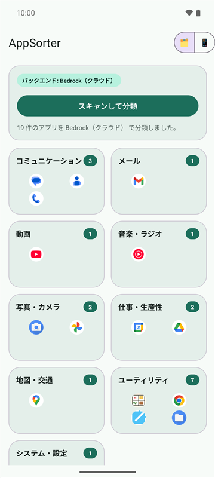
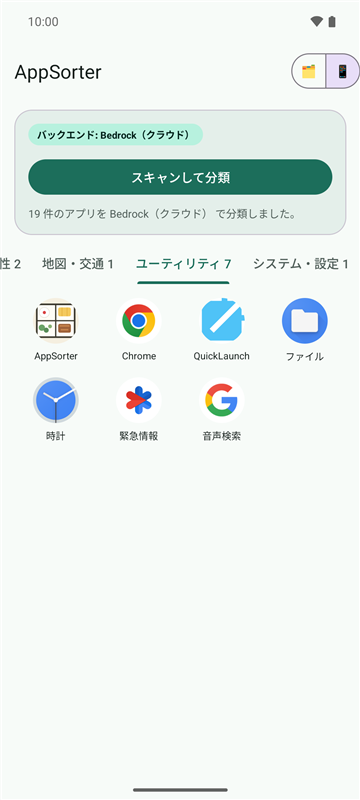
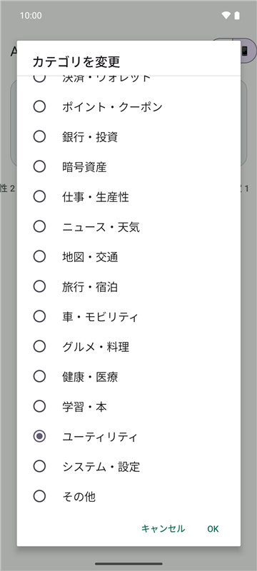
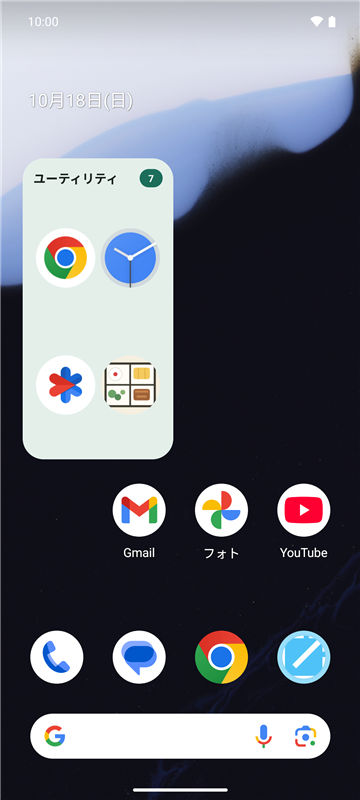

# AppSorter

端末にインストールされたアプリをカテゴリに自動で振り分け、ホーム画面のカテゴリウィジェット（ミニランチャー）から起動できるようにする Android アプリです。

> **試験的なプロジェクトです。** 個人の実験として作っているもので、無保証です。仕様は予告なく変わり、開発が止まることもあります。
> AI による分類は間違えることがあります。

| カテゴリ一覧 | タブ表示 | 分類の変更 | ホーム画面ウィジェット |
|:---:|:---:|:---:|:---:|
|  |  |  |  |

<sub>エミュレータ（Android 16）の標準アプリを、クラウド分類で振り分けた画面です。</sub>

## できること

- ランチャーに表示されるアプリを一覧し、カテゴリに分類する
  - **クラウド分類**: AWS 上の Bedrock（Claude Haiku）で分類する。バックエンドを自分でデプロイした場合のみ
  - **ルール分類**: 端末内のキーワードルールだけで分類する。バックエンドを用意しない場合や、回数上限・障害でクラウド分類が使えないときはこちらに切り替わる
- 分類結果は手動で変更でき、変更したものは再分類で上書きしない
- カテゴリごとのホーム画面ウィジェット。「使用状況へのアクセス」を許可すると直近30日の使用時間順、未許可なら名前順に並ぶ

動作環境: Android 8.0（API 26）以上

## 外部に送るデータ

- **クラウド分類を使う場合のみ**、インストール済みアプリの **アプリ名とパッケージ名** を、自分でデプロイした AWS のバックエンド（API Gateway → Lambda → Bedrock）に送ります
- アプリの使用状況（`PACKAGE_USAGE_STATS`）はウィジェットの並び順にだけ使い、端末の外には送りません
- バックエンドを設定せずにビルドした場合は、外部との通信は行いません（ルール分類のみ）

## 構成

- `app/` … Android アプリ（Kotlin）
- `terraform/` … クラウド分類用の AWS バックエンド（Cognito Identity Pool / API Gateway / Lambda / DynamoDB / Bedrock / Budgets）
  - デプロイ手順・設計の詳細は [terraform/README.md](terraform/README.md)
- `docs/` … 構成図
  - [全体構成](docs/図_全体構成.md) / [リクエストシーケンス](docs/図_リクエストシーケンス.md) / [AWS構成](docs/図_AWS構成.md)

## ビルド

```bash
./gradlew assembleDebug
```

クラウド分類を使う場合は、バックエンドをデプロイしたあと、`terraform output` の値を `local.properties` に書いてからビルドします（`local.properties` は Git に入れません）。

```properties
APPSORTER_API_URL=<api_invoke_url>
APPSORTER_COGNITO_IDENTITY_POOL_ID=<cognito_identity_pool_id>
APPSORTER_AWS_REGION=ap-northeast-1
```

## 費用について

バックエンドを自分の AWS アカウントにデプロイすると、そのアカウントに料金がかかります（主に Bedrock の呼び出し。ほかに Lambda・API Gateway・DynamoDB・CloudWatch）。

- 端末ごとの日次・月次の回数上限、全体の日次上限、月額予算（既定 $10）超過時の自動停止を備えていますが、AWS Budgets の判定は数時間遅れるため、上限ちょうどで止まる保証はありません
- 未認証の Cognito Identity Pool を使うため、ビルドした APK を配布すると、APK から接続先が分かります。他人に配る場合はこの点を理解したうえで上限値を設定してください

## 注意

- 本プロジェクトは個人によるもので、Anthropic・Amazon Web Services とは関係ありません。Claude・Amazon Bedrock などの名称は各社の商標です

## ライセンス

[MIT License](LICENSE)
