# AppSorter AWS 構成

> **この図の裏取り元**（AppSorter リポジトリ内、2026-10-19 時点の実装）
>
> - `terraform/modules/appsorter/cognito.tf`
> - `terraform/modules/appsorter/api_gateway.tf`
> - `terraform/modules/appsorter/lambda.tf`
> - `terraform/modules/appsorter/locals.tf`
> - `terraform/modules/appsorter/dynamodb.tf`
> - `terraform/modules/appsorter/budget.tf`
> - `terraform/modules/appsorter/reset.tf`
> - `terraform/modules/appsorter/variables.tf（既定値のみ）`
> - `terraform/modules/appsorter/lambda/handler.py`
> - `terraform/modules/appsorter/lambda/killswitch.py`
> - `terraform/modules/appsorter/lambda/reset.py`
> - `terraform/envs/prod/main.tf`
> - `terraform/envs/prod/providers.tf`
> - `terraform/envs/prod/variables.tf（既定値のみ）`
> - `terraform/envs/prod/outputs.tf`
>
> **役割分担**: この図は AWS インフラの物理構成（Terraform で作る実リソース・IAM ロール・ログ・条件付きリソース・tfstate）です。アプリ内部のコンポーネントを含む論理構成は `図_全体構成.md`、呼び出し順は `図_リクエストシーケンス.md` を参照してください。
> 破線 = 条件付きで作成されるリソース、またはデプロイ時のみ使う要素です。IAM と Budgets はグローバルサービスのため Region 枠の外に置いています。
> 固有値（AWSアカウントID・APIエンドポイントURL・Identity Pool ID・tfstate バケット名・通知先メール）は図に含めていません。数値は `variables.tf` の既定値です。

```mermaid
flowchart TB
  app["Android 端末<br/>AppSorter アプリ"]
  tf["terraform CLI (envs/prod)<br/>デプロイ時のみ"]
  mail["通知メール<br/>(宛先は tfvars)"]
  subgraph cloud["AWS Cloud"]
    direction TB
    budgets["AWS Budgets<br/>月額上限 (既定 10 USD)"]
    subgraph iam["IAM (グローバル)"]
      direction LR
      r_unauth["Cognito unauth ロール<br/>execute-api:Invoke<br/>(v1 POST /categorize のみ)"]
      r_lambda["lambda-exec<br/>logs / bedrock:InvokeModel /<br/>dynamodb:UpdateItem・ConditionCheckItem"]
      r_kill["killswitch-exec<br/>logs / dynamodb:UpdateItem"]
      r_reset["reset-exec<br/>logs / dynamodb:UpdateItem"]
      r_apigw["apigw-cloudwatch<br/>(条件付き: manage_apigw_account, 既定 true)"]
    end
    subgraph r1["Region ap-northeast-1 (東京)"]
      apiacct["API Gateway アカウント設定<br/>(CloudWatch ロール登録)<br/>条件付き: manage_apigw_account"]
      cognito["Cognito Identity Pool<br/>未認証 ID のみ / classic flow 無効"]
      apigw["API Gateway (REST, REGIONAL)<br/>stage v1 / POST /categorize<br/>AWS_IAM 認可 / JSON Schema 検証<br/>スロットル 10 rps, burst 20"]
      lambda["categorizer Lambda<br/>Python 3.12 / arm64<br/>予約同時実行 5"]
      profile["Bedrock 推論プロファイル<br/>jp.anthropic.claude-haiku-4-5<br/>(jp. クロスリージョン)"]
      fm1["Claude Haiku 4.5<br/>(基盤モデル)"]
      logs["CloudWatch Logs<br/>API access / Lambda 3 本<br/>(14 日保持)"]
      xray["AWS X-Ray<br/>(API ステージ / categorizer)"]
      ddb[("DynamoDB rate-limit<br/>オンデマンド / TTL / PITR")]
      kill["killswitch Lambda<br/>Python 3.12 / arm64"]
      reset["reset Lambda<br/>Python 3.12 / arm64"]
      sns["SNS budget-alert"]
      events["EventBridge ルール<br/>cron(0 0 1 * ? *)"]
      s3[("S3 (tfstate)<br/>appsorter/terraform.tfstate<br/>デプロイ時のみ")]
    end
    subgraph r3["Region ap-northeast-3 (大阪)"]
      fm3["Claude Haiku 4.5<br/>(基盤モデル)"]
    end
  end
  app -->|"GetId /<br/>GetCredentialsForIdentity"| cognito
  cognito -->|"AssumeRoleWithWebIdentity<br/>(unauthenticated)"| r_unauth
  app -->|"HTTPS + SigV4"| apigw
  apigw -->|"AWS_PROXY (29s)"| lambda
  apigw -->|"アクセスログ"| logs
  apigw -->|"トレース"| xray
  lambda -->|"ログ"| logs
  lambda -->|"トレース"| xray
  lambda -->|"Converse"| profile
  lambda -->|"TransactWriteItems"| ddb
  profile -->|"ルーティング"| fm1
  profile -->|"ルーティング"| fm3
  sns -->|"invoke"| kill
  kill -->|"UpdateItem<br/>locked=true"| ddb
  events -->|"invoke"| reset
  reset -->|"UpdateItem<br/>locked=false"| ddb
  budgets -->|"実績 100% 超過"| sns
  budgets -->|"予測 50% / 実績 80% / 実績 100%"| mail
  tf -.->|"state 読み書き<br/>(use_lockfile)"| s3
  classDef client fill:#dae8fc,stroke:#6c8ebf
  classDef compute fill:#d5e8d4,stroke:#82b366
  classDef store fill:#fff2cc,stroke:#d6b656
  classDef external fill:#e1d5e7,stroke:#9673a6
  classDef gate fill:#f8cecc,stroke:#b85450
  classDef cond fill:#f5f5f5,stroke:#999999,stroke-dasharray:5 5
  class app client
  class lambda,kill,reset compute
  class ddb store
  class profile,fm1,fm3,logs,xray,sns,events,budgets,mail external
  class cognito,apigw,r_unauth,r_lambda,r_kill,r_reset gate
  class r_apigw,apiacct,s3,tf cond
```

凡例: 青=クライアント / 赤=認証・入口・IAM / 緑=Lambda / 黄=データストア / 紫=マネージドサービス・外部 / 灰色破線=条件付き作成・デプロイ時のみ。IAM ロールと Lambda・API Gateway アカウント設定の対応はラベルで示し、線は省略しています（drawio 版も同じ）。
