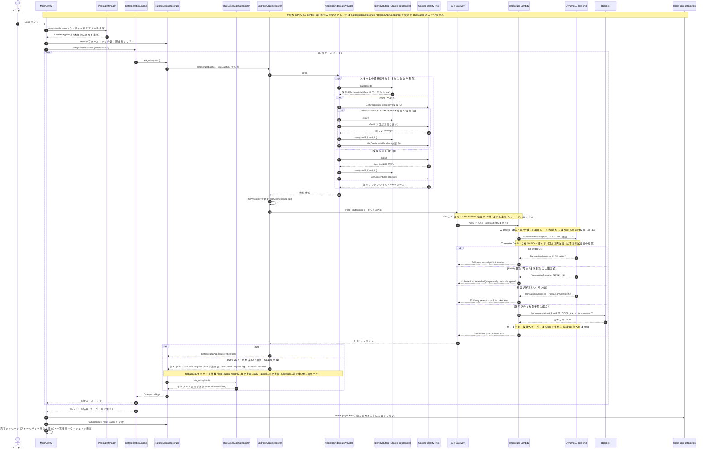

# AppSorter リクエストシーケンス

> **この図の裏取り元**（AppSorter リポジトリ内、2026-10-19 時点の実装）
>
> - `terraform/modules/appsorter/cognito.tf`
> - `terraform/modules/appsorter/api_gateway.tf`
> - `terraform/modules/appsorter/lambda.tf`
> - `terraform/modules/appsorter/locals.tf`
> - `terraform/modules/appsorter/dynamodb.tf`
> - `terraform/modules/appsorter/budget.tf`
> - `terraform/modules/appsorter/reset.tf`
> - `terraform/modules/appsorter/variables.tf（既定値のみ）`
> - `terraform/modules/appsorter/lambda/handler.py`
> - `terraform/modules/appsorter/lambda/killswitch.py`
> - `terraform/modules/appsorter/lambda/reset.py`
> - `terraform/envs/prod/main.tf`
> - `terraform/envs/prod/providers.tf`
> - `terraform/envs/prod/variables.tf（既定値のみ）`
> - `terraform/envs/prod/outputs.tf`
> - `app/build.gradle.kts（BuildConfig 項目名のみ）`
> - `app/src/main/AndroidManifest.xml`
> - `app/src/main/java/dev/dair/appsorter/MainActivity.kt`
> - `app/src/main/java/dev/dair/appsorter/categorizer/CategorizationEngine.kt`
> - `app/src/main/java/dev/dair/appsorter/categorizer/FallbackAppCategorizer.kt`
> - `app/src/main/java/dev/dair/appsorter/categorizer/BedrockAppCategorizer.kt`
> - `app/src/main/java/dev/dair/appsorter/categorizer/CognitoCredentialsProvider.kt`
> - `app/src/main/java/dev/dair/appsorter/categorizer/IdentityIdStore.kt`
> - `app/src/main/java/dev/dair/appsorter/categorizer/SigV4Signer.kt`
> - `app/src/main/java/dev/dair/appsorter/categorizer/RuleBasedAppCategorizer.kt`
> - `app/src/main/java/dev/dair/appsorter/data/AppCategoryRepository.kt`
> - `app/src/main/java/dev/dair/appsorter/data/AppCategoryDao.kt`
> - `app/src/main/java/dev/dair/appsorter/data/AppSorterDatabase.kt`
> - `app/src/main/java/dev/dair/appsorter/widget/CategoryWidgetProvider.kt`
> - `app/src/main/java/dev/dair/appsorter/widget/UsageRanker.kt`
>
> 固有値（AWSアカウントID・APIエンドポイントURL・Identity Pool ID・通知先メール等）は図に含めていません。アプリ側の接続値は `local.properties` → BuildConfig で注入される設計で、図ではプレースホルダ扱いです。
> 数値（スロットル・予約同時実行・上限回数・予算額など）は `variables.tf` の既定値です。実デプロイ値は tfvars で上書きされ得ます。

補足: フォールバックは `FallbackAppCategorizer` が `runCatching` で行い、失敗理由で分岐せず BedrockAppCategorizer 側で投げられた例外すべてが対象です（理由は件数と共に記録するだけ）。全体日次上限 (scope=global) は利用者向け表示では日次上限扱いです。
